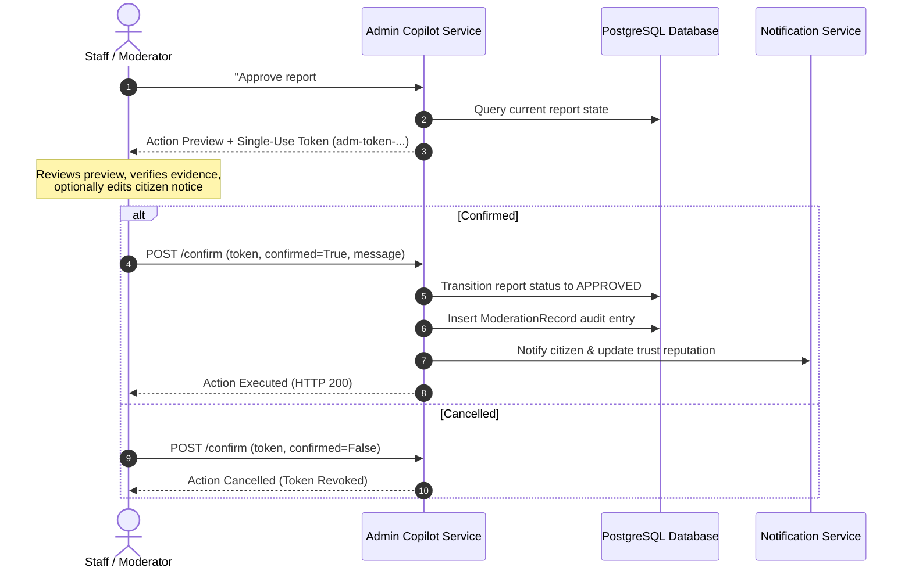

# Phase D: Agentic Admin & Moderator Copilot

**Project:** Nirapotta — Bangladesh Citizen Safety & Road Safety Intelligence Platform  
**Component:** Phase D — Agentic Admin & Moderator Copilot  
**Status:** Completed & Fully Verified (196 Backend Tests Passing, Frontend Type-Check Clean, Production Build Succeeded)  

---

## 1. System Overview

Phase D delivers an enterprise-grade **Agentic Admin & Moderator Copilot** for the Nirapotta platform. The copilot serves as an operational intelligence and decision-support assistant designed specifically for authorized administrative staff (`ADMIN` and `MODERATOR`).

### Core Design Principles
1. **Decision-Support, Not Autonomous Mutation:** The copilot cannot alter platform state directly from conversational chat. Every state-changing operation (`APPROVE_REPORT`, `REJECT_REPORT`, `REQUEST_MORE_INFO`, `START_REVIEW`) must generate an explicit confirmation token and preview, requiring a human moderator to confirm the action.
2. **Database Grounding & Zero Hallucination:** All summaries, lists, counts, and metrics are queried directly from the real database via controlled backend tools. When zero records match, the assistant accurately reports zero items and never invents synthetic reports or users.
3. **Strict Role-Based Access Control (RBAC):** Standard citizens (`USER` role) are strictly denied access and receive an immediate `HTTP 403 Forbidden` response. Both administrators and moderators are authorized to query platform telemetry and execute moderation actions.
4. **Complete Auditability:** Every confirmed action automatically logs an immutable `ModerationRecord` linking the moderator ID, action taken, internal notes, and timestamp.
5. **Multi-Lingual Intent Understanding:** The copilot parses natural-language queries in Bangla, English, and Banglish (e.g., *"কোন রিপোর্টগুলো পেন্ডিং আছে?"*, *"Show urgent blood requests"*, *"24 ghontar beshi pending report ache ki?"*).

---

## 2. Security & Authorization

Access to the copilot is protected at the API gateway layer using the `get_current_moderator_or_admin` dependency:

```python
async def get_current_moderator_or_admin(
    current_user: User = Depends(get_current_user),
) -> User:
    if current_user.role not in (UserRole.ADMIN, UserRole.MODERATOR):
        raise HTTPException(
            status_code=status.HTTP_403_FORBIDDEN,
            detail="Staff or Moderator privileges required",
        )
    return current_user
```

- **Citizen Access:** Any citizen attempting to post to `/api/v1/admin/ai-assistant/copilot` or its confirmation endpoint receives `403 Forbidden`.
- **Administrative Token Store:** Action confirmation tokens (`adm-token-*`) are held in a secure, memory-managed store with a 30-minute time-to-live (TTL). Single-use tokens prevent replay attacks; re-submitting a consumed token returns an explicit `ALREADY_PROCESSED` status.

---

## 3. The 8 Controlled Backend Tools

The copilot operates strictly through 8 typed tools in [`backend/app/services/admin_copilot.py`](file:///Users/alfi/report%20box/citizen-report-platform/backend/app/services/admin_copilot.py):

| Tool Name | Scope & Purpose | Security / Privacy Safeguards | Output Structure |
|---|---|---|---|
| `search_moderation_reports` | Search and filter reports across all statuses (`SUBMITTED`, `UNDER_REVIEW`, `NEEDS_MORE_INFORMATION`, `APPROVED`, `REJECTED`) | Staff-only; includes confidential reporter metadata | Filtered list with pagination, category names, district, timestamp |
| `get_moderation_report` | Retrieve deep report details for investigation | Staff-only; surfaces full `ModerationRecord` audit logs and internal notes | Complete incident breakdown, reporter email/name, prior moderation actions |
| `get_moderation_summary` | Aggregate factual moderation statistics from the DB | Staff-only; real-time SQL count queries | Counts by status, total count, factual summary statement |
| `search_blood_requests_admin` | Inspect active and unfulfilled emergency blood requests | Staff-only; reveals donor response counts and requester contacts | Blood group, hospital, urgency, units needed, donor responses |
| `get_platform_activity` | Overview of platform health and community activity | Staff-only; cross-table metric aggregation | Total reports, open reports, blood requests, active donors, flags, missing persons |
| `get_recent_moderation_activity` | Review chronological audit logs of moderation decisions | Staff-only; queries `ModerationRecord` table | Moderator names, actions, review notes, affected report titles |
| `identify_operational_attention_items` | Automated scanning for platform bottlenecks and stale items | Staff-only; flags reports pending >24–48h, unresponded emergency blood requests, pending safety flags | Typed attention items with severity (`CRITICAL`, `HIGH`, `MEDIUM`), age hours, and recommended actions |
| `prepare_moderation_action` | Draft a state-changing moderation preview | Validates allowable state transitions; generates single-use confirmation token | `ModerationActionPreview` with token, proposed action, rationale, suggested citizen message |

---

## 4. Human Confirmation Lifecycle

To preserve human agency and prevent accidental or autonomous state modifications, the system adheres to a strict two-step confirmation pattern:



### Transition Validation Rules
- `APPROVE_REPORT`: Allowed from `SUBMITTED`, `UNDER_REVIEW`, `NEEDS_MORE_INFORMATION`.
- `REJECT_REPORT`: Allowed from `SUBMITTED`, `UNDER_REVIEW`, `NEEDS_MORE_INFORMATION`.
- `REQUEST_MORE_INFO`: Allowed from `SUBMITTED`, `UNDER_REVIEW`.
- `START_REVIEW`: Allowed from `SUBMITTED`.

If a report's status changes concurrently between preview generation and confirmation, the confirmation execution halts with an explicit state conflict notice.

---

## 5. Multi-Lingual Intent Parsing

The copilot parses 11 distinct operational intents:
1. `GET_MODERATION_SUMMARY`: Overview of reports awaiting review or approved.
2. `SEARCH_MODERATION_REPORTS`: Filter reports by criteria.
3. `GET_MODERATION_REPORT`: Detailed inspection of a specific report.
4. `IDENTIFY_ATTENTION_ITEMS`: Identification of operational bottlenecks or stale reports.
5. `GET_PLATFORM_ACTIVITY`: Platform-wide telemetry.
6. `GET_RECENT_MODERATION_ACTIVITY`: Moderation audit logs.
7. `SEARCH_BLOOD_REQUESTS`: Review of blood assistance requests.
8. `PREPARE_MODERATION_ACTION`: Preparation of moderation actions.
9. `CONFIRM_MODERATION_ACTION`: Execution confirmation.
10. `CLARIFY_QUERY`: Request for clarification when queries are vague.
11. `GENERAL_ADMIN_ASSISTANCE`: Guidance on operational procedures.

---

## 6. API Endpoints

### 1. Conversational Query
- **`POST /api/v1/admin/ai-assistant/copilot`**  
  *(Alias: `POST /api/v1/admin/copilot`)*
  - **Headers:** `Authorization: Bearer <token>` (Staff or Moderator)
  - **Request Body:**
    ```json
    {
      "message": "Which reports have been waiting for review for more than 24 hours?",
      "conversation_id": "optional-uuid",
      "report_id": "optional-report-uuid",
      "history": [],
      "lang": "en"
    }
    ```
  - **Response Body:** Includes conversational reply, intent, executed tool name, typed data payloads (`search_results`, `summary`, `activity`, `attention_items`, etc.), and `action_preview` if an action was requested.

### 2. Action Confirmation
- **`POST /api/v1/admin/ai-assistant/copilot/confirm`**  
  *(Alias: `POST /api/v1/admin/copilot/confirm`)*
  - **Headers:** `Authorization: Bearer <token>`
  - **Request Body:**
    ```json
    {
      "confirmation_token": "adm-token-a1b2c3d4-...",
      "confirmed": true,
      "moderation_notes": "Verified incident via traffic surveillance footage.",
      "citizen_message": "Your report has been verified and published to the safety map."
    }
    ```
  - **Response Body:**
    ```json
    {
      "success": true,
      "action_type": "APPROVE_REPORT",
      "target_id": "report-uuid-...",
      "status_after": "APPROVED",
      "message": "Action APPROVE_REPORT successfully executed on report.",
      "audit_record_id": "mod-uuid-..."
    }
    ```

---

## 7. Frontend Integration

1. **`AdminCopilotModal.tsx`**:
   - Modern glassmorphism UI styled with Tailwind CSS and Lucide React icons.
   - Zero emojis in code or UI labels.
   - Dedicated interactive renderers for:
     - Moderation summary scorecards.
     - Operational attention cards with severity badges (`CRITICAL`, `HIGH`, `MEDIUM`).
     - Report cards with direct links to `/admin/reports/[id]`.
     - Blood request monitoring cards.
     - Audit activity timelines.
     - Interactive **Action Confirmation Card** with editable notes and citizen feedback inputs, Cancel button, and Confirm button.
2. **`AdminNav.tsx`**:
   - Integrated Copilot AI button in the top administration bar across all admin routes.
3. **`admin/page.tsx`**:
   - Copilot launcher in the administrative dashboard action strip.

---

## 8. Verification & Test Suite

The test suite validates both unit behavior and end-to-end HTTP request flows:
- **`backend/tests/test_admin_copilot.py`**:
  - `test_citizen_access_forbidden`: Verifies standard citizens receive HTTP 403.
  - `test_moderator_and_admin_authorized`: Verifies both staff roles are granted access.
  - `test_tool_search_moderation_reports`: Verifies multi-parameter report searches.
  - `test_tool_get_moderation_report_with_notes`: Verifies deep inspection and audit records.
  - `test_tool_get_moderation_summary`: Verifies factual database counts.
  - `test_tool_search_blood_requests_admin`: Verifies administrative blood request queries.
  - `test_tool_get_platform_activity`: Verifies platform metrics aggregation.
  - `test_tool_identify_operational_attention_items`: Verifies stale report detection.
  - `test_tool_prepare_and_confirm_moderation_action`: Verifies the complete preview-to-execution confirmation cycle.
  - `test_confirmation_replay_prevention`: Verifies single-use tokens cannot be re-executed.
  - `test_copilot_chat_endpoint_e2e`: Verifies end-to-end API integration and response structures.

**Pytest Result:** 196 passed out of 196 tests in 67.33s.  
**TypeScript Type-Check:** Clean (0 errors).  
**Production Build:** Clean (45/45 static/dynamic routes compiled).
