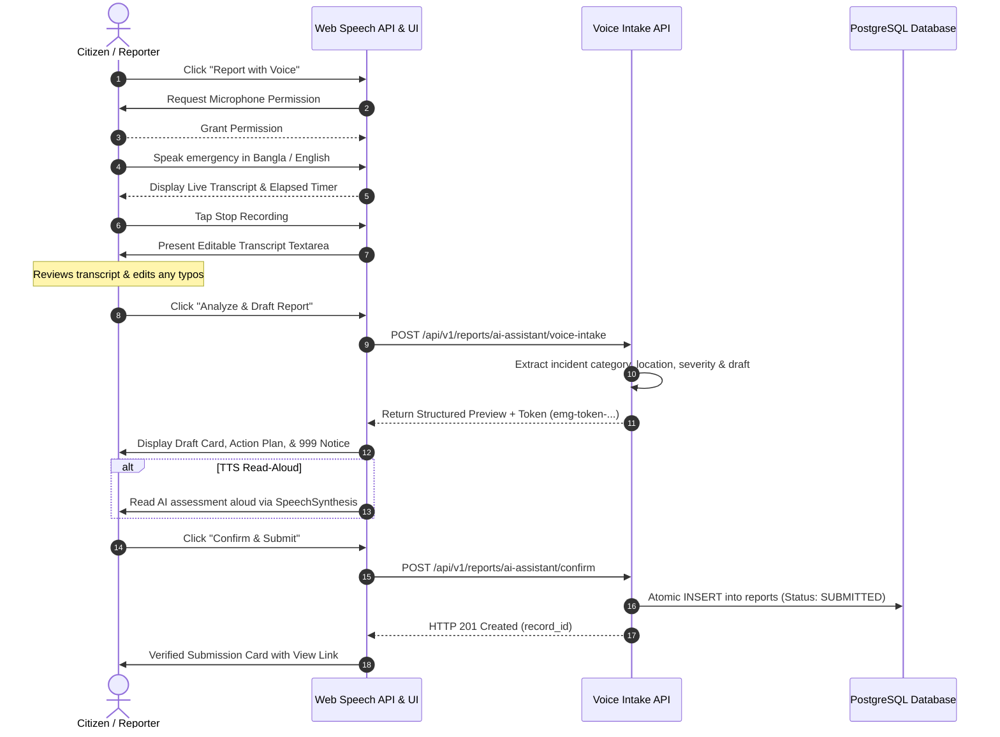

# Phase E: AI Voice & Audio Emergency Intake

**Project:** Nirapotta — Bangladesh Citizen Safety & Road Safety Intelligence Platform  
**Component:** Phase E — AI Voice & Audio Emergency Intake  
**Status:** Completed & Fully Verified (207 Backend Tests Passing, Frontend Type-Check Clean, Production Build Succeeded)  

---

## 1. System Overview & Architecture

Phase E introduces an accessible, voice-enabled emergency reporting interface for the Nirapotta platform. The system empowers citizens—including those in distress, driving, or with limited literacy—to report safety emergencies, road collisions, hazards, and urgent blood requirements using natural spoken speech in Bangla, English, or Banglish.

### Key Architecture Principles:
1. **Client-Side Speech Recognition:** Speech-to-text is performed natively using the Web Speech API (`webkitSpeechRecognition` / `SpeechRecognition`), avoiding expensive third-party speech vendor dependencies and ensuring zero audio leaves the user's device unencrypted.
2. **Review Before Submission:** Spoken audio is never converted directly into an active database incident. The citizen is presented with the recognized transcript, given full capability to edit misheard words, and must explicitly confirm a structured incident preview before any database record is created.
3. **Transient Processing (Zero Audio Retention):** Raw audio streams are never saved to server disks or databases (`audio_retention_policy: "TRANSIENT_PROCESSED_NOT_STORED"`).
4. **Emergency Safety & Non-Dispatcher Role:** Nirapotta AI explicitly identifies itself as an assistive civic documentation tool—never an emergency dispatcher. In any life-threatening situation, prominent banners instruct the citizen to call National Emergency 999 immediately.
5. **Architectural Reuse:** Voice intake directly leverages the Phase A emergency extraction engine, ensuring consistent category mapping, blood group parsing, location extraction, and atomic confirmation token workflows.

---

## 2. Request & Execution Flow



---

## 3. Supported Browser APIs & Fallback Behavior

### 1. Web Speech Recognition (`SpeechRecognition` / `webkitSpeechRecognition`)
- Supported out of the box in Google Chrome, Chromium browsers, Microsoft Edge, Safari (iOS 14.5+ / macOS 14+), and Android WebView/Capacitor.
- Configured dynamically based on user language:
  - Bangla mode (`lang == "bn"`): `recognition.lang = "bn-BD"`.
  - English mode (`lang == "en"`): `recognition.lang = "en-US"`.
- Features continuous capture (`continuous = true`) and real-time interim results (`interimResults = true`).

### 2. Media Devices API (`navigator.mediaDevices.getUserMedia`)
- Hardware permission check to ensure microphone access before opening audio channels.
- Real-time detection of microphone disconnects, device busy errors, or permission denials (`NotAllowedError`).

### 3. Web Speech Synthesis (`window.speechSynthesis`)
- Accessible text-to-speech engine reading the AI's reply and follow-up questions aloud in Bengali or English.
- User control: Toggle narration on/off, stop playback at any time.

### 4. Robust Fallbacks
- **Browser Unsupported:** If `SpeechRecognition` is absent (e.g., standard desktop Firefox), the modal gracefully shifts to an informative fallback card with an inline text editing area.
- **Permission Denied:** If the citizen denies microphone permissions, an actionable guidance card explains how to enable microphone permissions in the browser address bar, while keeping the typing option immediately available.
- **No Speech Detected:** Friendly alert prompt encouraging the user to speak closer to the device.

---

## 4. Privacy & Safety Safeguards

| Safeguard | Implementation & Verification |
|---|---|
| **Zero Raw Audio Storage** | Audio streams exist solely in browser memory during recording. No WAV/MP3 files are transmitted or persisted on disk or database. |
| **No Auto-Submit on Stop** | Stopping recording transitions the interface to a "Transcribed" review state. The citizen must review and click "Analyze", then "Confirm". |
| **Edit Tracking** | The backend tracks whether the citizen modified the automated transcript (`was_edited: true/false`). |
| **Emergency 999 Banner** | Prominently displayed across all phases with a one-click `tel:999` call shortcut. |
| **No Fabricated Phone Numbers** | Only official emergency hotlines (999) are referenced; no fake numbers or claims of responder dispatch. |
| **Replay & Duplicate Protection** | Re-submitting a previously confirmed token returns cached confirmation without creating duplicate DB records. |
| **Authentication Requirement** | Anonymous callers attempting to finalize report submission receive `HTTP 401 Unauthorized`. |

---

## 5. API Endpoints

### 1. Voice Emergency Intake
- **`POST /api/v1/reports/ai-assistant/voice-intake`**  
  *(Alias: `POST /api/v1/emergency/ai-assistant/voice-intake`)*
- **Request Body (`VoiceEmergencyIntakeRequest`):**
  ```json
  {
    "transcript": "Severe multi-vehicle collision near Dhanmondi 27. Two people injured.",
    "raw_transcript": "Severe multi-vehicle collision near Dhanmondi 27",
    "audio_duration_seconds": 6.8,
    "conversation_id": "optional-uuid",
    "current_latitude": 23.7465,
    "current_longitude": 90.3745,
    "current_location_text": "Dhanmondi, Dhaka",
    "lang": "en"
  }
  ```
- **Response Body (`VoiceEmergencyIntakeResponse`):**
  ```json
  {
    "reply": "I have drafted your incident report based on the details provided. Please review it below.",
    "follow_up_question": null,
    "missing_fields": [],
    "is_ready_for_review": true,
    "emergency_type": "INCIDENT",
    "extracted_fields": {
      "title": "Public Safety Incident",
      "category_slug": "public-safety",
      "location_text": "Dhanmondi 27",
      "severity": "High"
    },
    "draft_report": {
      "title": "Public Safety Incident near Dhanmondi 27",
      "category_name": "Public Safety",
      "category_slug": "public-safety",
      "description": "Severe multi-vehicle collision near Dhanmondi 27. Two people injured.",
      "location_text": "Dhanmondi 27",
      "severity": "High"
    },
    "emergency_notice": "Emergency Notice: In any life-threatening situation, dial National Emergency 999 directly.",
    "conversation_id": "conv-uuid-...",
    "confirmation_token": "token-uuid-...",
    "input_mode": "voice",
    "transcript": "Severe multi-vehicle collision near Dhanmondi 27. Two people injured.",
    "raw_transcript": "Severe multi-vehicle collision near Dhanmondi 27",
    "audio_duration_seconds": 6.8,
    "was_edited": true,
    "audio_retention_policy": "TRANSIENT_PROCESSED_NOT_STORED",
    "speech_synthesis_hint": "I have drafted your incident report based on the details provided. Please review it below."
  }
  ```

### 2. Explicit Confirmation
- **`POST /api/v1/reports/ai-assistant/confirm`**
  - Requires `Authorization: Bearer <token>`
  - Atomically creates `Report` or `BloodRequest` in PostgreSQL.

---

## 6. Test Suite & Verification Results

### Backend Automated Tests (`tests/test_voice_emergency_intake.py`):
1. `test_voice_intake_empty_transcript_fails`: Rejects empty transcript with HTTP 400.
2. `test_voice_intake_excessively_long_transcript_fails`: Rejects transcripts >4000 chars with HTTP 422.
3. `test_voice_intake_english_incident_complete`: Complete English transcript produces draft & confirmation token.
4. `test_voice_intake_bangla_incident_missing_location`: Bangla transcript missing location prompts follow-up question.
5. `test_voice_intake_banglish_blood_request`: Extracts blood group, units, hospital, and urgency in Banglish.
6. `test_voice_intake_tracks_was_edited`: Validates `was_edited=True` when citizen modifies raw transcript.
7. `test_voice_intake_was_not_edited`: Validates `was_edited=False` when submitted verbatim.
8. `test_voice_intake_end_to_end_confirmation_and_creation`: Full cycle from voice intake to database insertion.
9. `test_voice_intake_replay_and_duplicate_prevention`: Ensures duplicate tokens return cached results.
10. `test_voice_intake_unauthenticated_confirmation_rejected`: Anonymous confirmation rejected with HTTP 401.
11. `test_voice_intake_alias_endpoint`: Verifies `/emergency/ai-assistant/voice-intake` route.
12. `test_voice_intake_provider_failure_fallback`: Graceful deterministic fallback when AI is unavailable.

**Pytest Full Suite Result:** **207 passed out of 207 tests (100% pass rate).**  
**TypeScript Type-Check:** **0 errors.**  
**Production Build:** **45/45 routes compiled cleanly.**

---

## 7. Known Limitations & Browser Notes

1. **Browser Speech Recognition Support:**
   - Chrome, Edge, Safari (iOS 14.5+), and Android WebView natively support the Web Speech API.
   - Desktop Firefox does not currently support the W3C Web Speech Recognition API natively; for Firefox users, Nirapotta automatically displays the accessible text fallback interface without blocking report creation.
2. **Ambient Noise:**
   - In extremely noisy environments (busy Dhaka intersections), background speech may intermittently affect speech recognition accuracy. The transcript editing screen explicitly allows citizens to verify and correct recognized text before submission.

---

## 8. Manual Testing Instructions

1. Navigate to `/reports/create`.
2. Click the green **Report with Voice** button.
3. Allow microphone permission when prompted by the browser.
4. Speak an emergency incident (e.g., *"Bus and rickshaw accident near Dhanmondi 27, two passengers injured"*).
5. Observe the live elapsed timer and transcription preview.
6. Tap the red stop button.
7. Verify that the transcript appears in the editable box. Add or modify a word to test edit tracking.
8. Click **Analyze & Draft Report**.
9. Verify that the draft preview card, 999 notice, and action plan appear.
10. Tap the **Listen** button to test SpeechSynthesis text-to-speech.
11. Click **Confirm & Submit** to verify report creation in the database.
