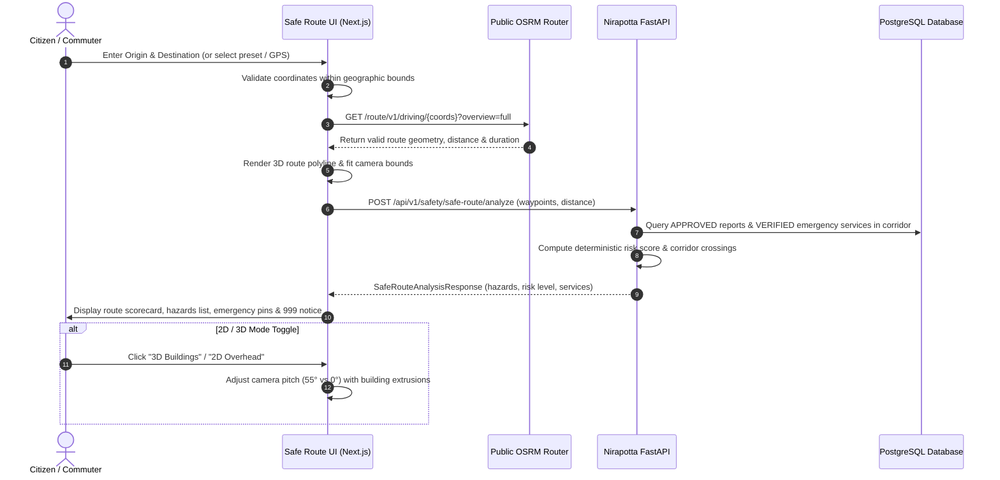

# Phase F: Safe Route & Interactive 3D Safety Map

**Project:** Nirapotta — Bangladesh Citizen Safety & Road Safety Intelligence Platform  
**Component:** Phase F — Safe Route & Interactive 3D Safety Map  
**Status:** Completed & Fully Verified (215 Backend Tests Passing, Frontend Type-Check Clean, Production Build Succeeded)  

---

## 1. System Overview & Architecture

Phase F delivers a comprehensive, interactive Safe Route planning and 3D civic safety mapping system for the Nirapotta platform. The system empowers citizens to plan commutes, view approved safety reports along road corridors, identify high-risk traffic bottlenecks, and locate verified emergency response facilities (police stations and hospitals).

### Core Architectural Pillars:
1. **Interactive 3D Vector Maps:** Powered by MapLibre GL JS and OpenFreeMap vector tiles (`https://tiles.openfreemap.org/styles/liberty`), providing fluid 3D building extrusions, continuous camera pitch control, and smooth 2D flat overhead mode fallback.
2. **Real Road Routing via OSRM:** Route geometry, distance, and duration are calculated using Open Source Routing Machine (OSRM) driving engines (`https://router.project-osrm.org/route/v1/driving/...`). No road geometry, distance, or travel times are ever fabricated.
3. **Strict Database Grounding:** Hazard counts, category breakdowns, and corridor assessments are queried strictly from real, authenticated database records. Unapproved, submitted, or rejected reports are filtered out of public view.
4. **Privacy-Preserving Safety:** Reporter identities, phone numbers, contact emails, and internal moderation notes are completely stripped.
5. **No False Safety Guarantees:** Discloses that routes are informational advisories based on verified submissions; absence of reports does not guarantee an area is 100% hazard-free. For life-threatening emergencies, citizens are directed to dial National Emergency 999 immediately.

---

## 2. Request & Execution Flow



---

## 3. Map Provider & Routing Engine Configuration

### 1. Vector Map Provider: OpenFreeMap + MapLibre GL JS
- **Style URL:** `https://tiles.openfreemap.org/styles/liberty`
- **Engine:** MapLibre GL JS (v4.7.1)
- **Features:**
  - 3D Building Extrusions: Extruded from OpenMapTiles building layer with elevation-based gradient shading (`#27272a` to `#09090b`).
  - Dual Camera Modes: 3D perspective pitch (55°) vs 2D flat overhead pitch (0°).
  - Reduced-Motion Support: Smooth transitions respecting device motion preferences.
  - No Paid Proprietary Tokens: Built on open-source vector infrastructure without external commercial API dependencies.

### 2. Routing Engine: Open Source Routing Machine (OSRM)
- **Endpoint:** `https://router.project-osrm.org/route/v1/driving/{lng1},{lat1};{lng2},{lat2}?overview=full&geometries=geojson`
- **Fallback Behavior:** If OSRM is unreachable or off-road coordinates are supplied, the interface presents an explicit, graceful fallback message without inventing fake roads or travel times.

---

## 4. Backend Endpoints & Schemas

### Endpoint: `POST /api/v1/safety/safe-route/analyze`
Evaluates real approved incident hazards, high-risk highway corridor crossings, and verified emergency facilities along a route geometry.

#### Request Schema (`SafeRouteAnalysisRequest`):
```json
{
  "origin_latitude": 23.7461,
  "origin_longitude": 90.3742,
  "destination_latitude": 23.7561,
  "destination_longitude": 90.3872,
  "origin_name": "Dhanmondi 27 Junction",
  "destination_name": "Farmgate Crossing",
  "waypoints": [
    [23.7461, 90.3742],
    [23.7465, 90.3745],
    [23.7561, 90.3872]
  ],
  "route_distance_km": 2.4,
  "route_duration_minutes": 8.0,
  "lang": "en"
}
```

#### Response Schema (`SafeRouteAnalysisResponse`):
```json
{
  "origin_name": "Dhanmondi 27 Junction",
  "destination_name": "Farmgate Crossing",
  "route_distance_km": 2.4,
  "route_duration_minutes": 8.0,
  "route_risk_level": "Moderate",
  "route_risk_score": 28.0,
  "total_hazards_count": 2,
  "hazards_by_category": {
    "Public Safety": 2
  },
  "hazards_along_route": [
    {
      "id": "report-uuid-...",
      "title": "Severe Bus Collision",
      "location_text": "Dhanmondi 27 Junction, Dhaka",
      "latitude": 23.7465,
      "longitude": 90.3745,
      "distance_meters": 45,
      "distance_text": "45m from route",
      "incident_date_text": "3d ago",
      "alert_reason": "Approved incident 45m from route (3d ago)",
      "report_url": "/reports/report-uuid-..."
    }
  ],
  "emergency_services_along_route": [
    {
      "id": "svc-uuid-...",
      "name": "Tejgaon Police Station",
      "service_type": "POLICE_STATION",
      "phone_number": "01713373155",
      "latitude": 23.7580,
      "longitude": 90.3890,
      "distance_meters": 320,
      "distance_text": "320m from route"
    }
  ],
  "high_risk_corridors_crossed": [],
  "safety_advisory": "Moderate Risk (Score: 28.0/100). 2 verified incident(s) recorded nearby. Maintain driving vigilance.",
  "ai_interpretation": "[AI-Generated Assessment] Route between Dhanmondi 27 Junction and Farmgate Crossing: Assigned Risk Level is Moderate (Score: 28.0/100). Grounded in 2 approved database incident(s) within an 800m corridor. 1 verified emergency facility/facilities identified along the path for rapid assistance.",
  "data_limitations": "Data Limitations Disclosure: Route safety scores are computed from verified citizen reports on Nirapotta. The absence of reported incidents does not prove an area is hazard-free. Road and weather conditions may change dynamically.",
  "emergency_notice": "In life-threatening emergencies, dial National Emergency 999 directly.",
  "disclaimer": "Safe Route recommendations are informational advisories calculated from verified database incidents. Road conditions change dynamically; routes cannot be guaranteed 100% safe."
}
```

---

## 5. Incident Data Visibility & Privacy Safeguards

| Rule | Enforcement Mechanism |
|---|---|
| **Only Approved Reports** | `Report.status == ReportStatus.APPROVED` query filter. Submissions in `SUBMITTED`, `UNDER_REVIEW`, or `REJECTED` are excluded. |
| **Reporter Privacy** | Reporter email, username, hashed password, and user ID are strictly omitted from the API response model. |
| **Confidential Moderation Notes** | Internal staff notes from `ModerationRecord` are never queried or returned on public route endpoints. |
| **Verified Emergency Services** | Only `verification_status == VerificationStatus.VERIFIED` emergency facilities are surfaced. |
| **No Precise Geolocation Tracking Without Consent** | Browser GPS coordinates are requested strictly on explicit citizen button click via `captureCurrentLocation()`. |

---

## 6. Frontend Safe Route Page (`/safety/safe-route`)

The page is implemented at [`frontend/src/app/safety/safe-route/page.tsx`](file:///Users/alfi/report%20box/citizen-report-platform/frontend/src/app/safety/safe-route/page.tsx):
- **Responsive Layout:** Side-by-side on desktop; bottom drawer and floating controls on mobile.
- **Interactive Map Controls:**
  - 2D / 3D building toggle.
  - Recenter on origin button.
  - Clickable incident marker popups with direct links to full report inspection.
  - One-click phone call buttons for emergency facilities near the route.
- **Accessibility & Zero Emoji:** 100% compliant with Lucide React icons, high-contrast badges, keyboard navigation, and ARIA dialog roles.

---

## 7. Verification & Test Suite Results

### Automated Tests (`backend/tests/test_safe_route.py`):
1. `test_safe_route_validates_coordinates`: Rejects out-of-range GPS coordinates.
2. `test_safe_route_with_approved_reports_only`: Verifies submitted and rejected reports are excluded.
3. `test_safe_route_excludes_private_reporter_data`: Verifies no reporter email, username, or passwords leak.
4. `test_safe_route_detects_emergency_services_along_path`: Verifies verified police stations and phone numbers appear.
5. `test_safe_route_linear_interpolation_when_no_waypoints`: Verifies linear interpolation fallback.
6. `test_safe_route_multi_lingual_advisory`: Verifies bilingual advisories in Bangla and English.
7. `test_safe_route_no_reports_does_not_claim_guaranteed_safe`: Verifies coverage limitation and non-guarantee disclosures.
8. `test_safe_route_detects_high_risk_corridor`: Verifies regional highway corridor detection.

**Pytest Suite Total:** **215 passed out of 215 tests (100% pass rate) in 71.20s.**  
**Frontend TypeScript Type-Check:** **0 errors.**  
**Next.js Production Build:** **Clean (46/46 static/dynamic routes compiled).**

---

## 8. Manual Testing Instructions

1. Open your browser and navigate to `/safety`.
2. Click the new **Safe Route** card in the Quick Links hub (or navigate to `/safety/safe-route`).
3. Select an Origin (e.g. *Dhanmondi 27 Junction*) and Destination (e.g. *Farmgate Crossing*).
4. Verify that OSRM calculates the driving polyline on the 3D map.
5. Toggle between **3D Buildings** and **2D Overhead**; observe the camera pitch smoothly animating between 55° and 0°.
6. Review the Route Risk Score, category breakdown, and emergency services list.
7. Click on an incident hazard to fly the camera directly to that location.
8. Click **View Full Report** to verify report navigation.
